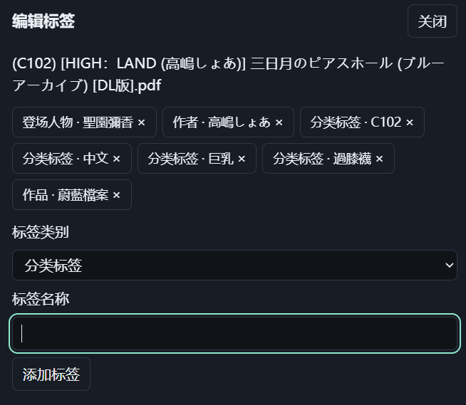
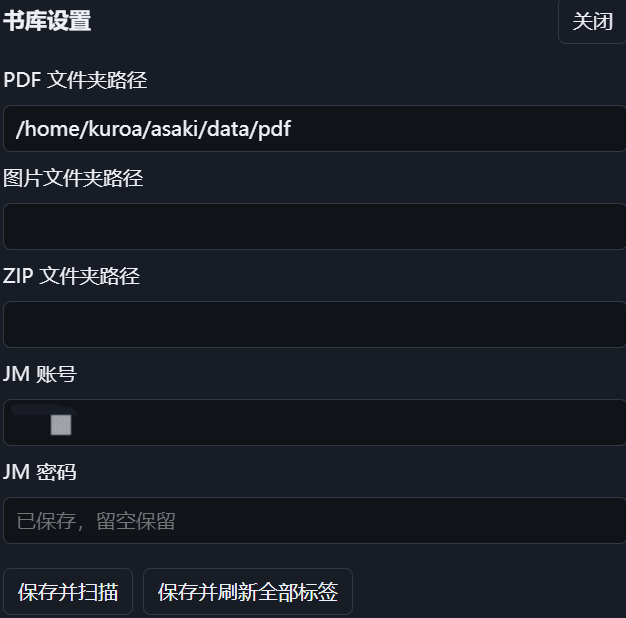

# 同人志网页阅读器

用于个人内网书库。支持 PDF、图片目录和 ZIP、文件名搜索、JM 标签筛选、列表与封面切换、可调速自动滚动。

**本项目仅提供给内网自用。对外开放或转发端口的风险由操作者自行承担。** 内网中能访问服务端口的设备可以浏览书库。默认 HTTP 不加密。

**本项目由AI辅助开发**

## 界面示例

书库主页示例如下，可切换列表查看和封面查看。


可以通过一个或多个标签来过滤书库，同时支持列表查看和封面查看。


书库顶部的搜索框会实时按名称匹配。PDF 和 ZIP 按文件名搜索，图片书籍按文件夹名搜索，均支持不区分大小写的部分匹配，也可和标签筛选一起使用。

启动后会在后台自动拉取jm标签，标签也可以自行增加和删除。



支持自动滚动，解放你的双手。


## 运行

先在主机上安装所需依赖：

| 依赖 | 用途与版本 |
| --- | --- |
| Python 和 pip | 推荐 Python 3.11，本项目仅在 3.11 下测试。其他版本需为 Python 3.9 或以上，并满足下列 Python 包的版本要求。 |
| Flask | `3.0.3`，提供网页和 API。 |
| jmcomic | `2.6.10`，查询 JM 标签。 |
| Pillow | `10.3` 或以上，读取图片尺寸并生成缩略图。 |
| Poppler | 阅读 PDF 时需要 `pdfinfo` 和 `pdftoppm`。只看图片书籍或 ZIP 时可省略。 |
| Git | 用于克隆和更新项目。 |

Flask、jmcomic、Pillow 及其依赖会由下方的 `pip install` 一并安装。Poppler 是系统工具，需通过系统包管理器安装。在 Debian 或 Ubuntu 上可以执行：

```bash
sudo apt install poppler-utils
```

安装系统依赖后，克隆并运行：

```bash
git clone https://github.com/CCzer/Doujinshi_Viewer.git
cd Doujinshi_Viewer
python -m pip install -r requirements.txt
python viewer.py
```

服务默认监听 `0.0.0.0:8000`。主机上打开 [http://127.0.0.1:8000](http://127.0.0.1:8000)，其他内网设备使用主机的内网 IP 和相同端口，例如 `http://192.168.1.23:8000`。可通过 `--host` 和 `--port` 修改监听地址和端口。

## 更新

先停止正在运行的 Viewer，在项目目录执行以下命令，再刷新浏览器页面。个人配置和数据库会继续使用原有文件。

```bash
git pull --ff-only
python -m pip install -r requirements.txt
python viewer.py
```

## 后台运行和停止

个人内网使用，想从 SSH 退出后继续运行，`screen` 就够用。进入项目目录后执行：

```bash
screen -S jm-viewer
python viewer.py
```

- **转到后台**：先按 `Ctrl+A`，松开后再按 `D`。Viewer 会继续运行。
- **回到会话**：执行 `screen -r jm-viewer`，即可查看日志。
- **停止 Viewer**：回到会话后按 `Ctrl+C`，再输入 `exit` 结束 screen 会话。前台运行时可直接按 `Ctrl+C`。
- **重启 Viewer**：回到会话后按 `Ctrl+C`，重新执行启动命令，再按 `Ctrl+A`、`D` 转到后台。

如果希望 Linux 主机开机自动启动、进程异常退出后自动重启，再考虑用 systemd 服务管理。

## 快速开箱配置

1. 运行 `python viewer.py` 后打开网页，按首次配置向导设置管理员密码。
2. 将主机上的已有的 PDF、图片书籍和 ZIP 目录按配置向导分别填写到配置中，暂时不用的类型可留空。你也可以把 PDF、图片书籍和 ZIP 分别放进 `books/pdf`、`books/images` 和 `books/zip`，然后保留默认路径。目录格式可参考下面文件夹示例段落。
3. 填写 JM 账号和密码以登录获取标签。两项都留空时会尝试匿名搜索（匿名搜索会有大部分本子无法拉取tag）。保存后按提示重启 Viewer。



## 详细配置说明

未创建个人配置文件，或尚未设置管理员密码时，打开网页就会进入配置向导。已有 SQLite 数据库也可以完成向导。此时能访问服务的内网设备都可以完成配置。依次设置管理员密码、JM 账号密码、PDF 路径、图片路径和 ZIP 路径。三个路径默认填好推荐目录，可以改成自己的目录，也可以清空任一路径以停用对应来源。每一步都有路径和目录结构示例。保存后按网页提示，在主机上重启 Viewer 并刷新页面。

首次配置完成后，管理员密码只以哈希形式写入个人配置。重启后，包括主机本地浏览器在内，修改设置都需要输入管理员密码。JM 密码保存在个人配置文件中，网页不会回显。密码框留空会保留原 JM 密码，清空账号并保留密码框为空会清除 JM 登录配置。个人配置、样本、数据库和本地工具数据均被 Git 忽略。

文件夹路径可以填写绝对路径，也可以填写相对项目目录的路径。可用 `--config` 指定配置文件，用 `--db` 指定 SQLite 文件。手动编辑配置时，可参考 `config.example.json`。

- 「保存并扫描」重新扫描目录，搜索新增和待处理的书籍。
- 「保存并刷新全部标签」重新搜索当前书库的所有书籍。已有标签只有在成功获取新标签后才替换。
- 每本书可通过「编辑标签」手动添加或删除作品、人物、分类及作者标签。手动修改会参与筛选，刷新 JM 标签后仍会保留。
- 搜索没有匹配时自动添加可筛选的「未分类」标签。重新搜索成功后会用匹配结果替换。
- 每批搜索复用同一个 JM 客户端。有账号时登录一次，未设置账号时尝试匿名搜索。只发送去除方括号标签和圆括号附注后的完整标题，必要时尝试完整译名。多个标题匹配时采用 JM 返回顺序中第一本匹配书籍，入库其作品、登场人物、分类标签和作者。
- 正常重启会重试待索引、未匹配和索引失败的书。已成功索引且文件未变动的书会直接使用已有标签。启动参数 `--no-jm` 跳过联网打标签。

## 文件夹示例

项目自带三个空的推荐目录。可以直接按类型放入文件并保留向导里的默认路径，也可以在「设置」中分别指定已有的书库目录。书库内容不会被 Git 跟踪。

```text
jm_viewer/
├── viewer.py
├── config.example.json
├── data/
│   ├── config.json
│   └── library.sqlite3
└── books/
    ├── pdf/
    │   ├── [作者] 标题.pdf
    │   └── 合集/
    │       └── 另一标题.pdf
    ├── zip/
    │   └── [作者] 标题三.zip
    └── images/
        ├── [作者] 标题一/
        │   ├── 1.webp
        │   ├── 2.png
        │   └── 10.jpg
        └── 标题二/
            ├── 第1话/
            │   ├── 1.jpg
            │   └── 2.webp
            └── 第2话/
                └── 1.png
```

默认路径分别是 `books/pdf`、`books/images` 和 `books/zip`。PDF 会递归扫描。图片根目录下每个一级子目录视为一本书，书内可以继续嵌套章节目录。目录和文件名按自然数字顺序排列，支持 WebP、PNG、JPEG、GIF 和 BMP。

ZIP 路径单独配置，支持递归扫描，每个 ZIP 算一本书。压缩包里可以有多层文件夹，按自然数字顺序逐页读取，无需解压到磁盘。跳过加密图片和解压后超过 64 MiB 的单页。

「列表」使用纯文字布局。「封面」使用扫描顺序中的第一张图片或 PDF 第一页作为预览，ZIP 同样使用排序后的第一张图。每页显示 20 本，标签索引的四类各显示使用次数最多的 15 个标签，每类可单独点「展开」查看其余标签。阅读时，左侧滑条调整页面大小，右侧滑条调整自动滚动速度。

- 「无缝滚动」是默认方式，所有页面连续排列，可使用自动滚动。
- 「点击翻页」每次显示一页，点击阅读区左半边返回上一页，点右半边进入下一页。可勾选「反转点击方向」。
- 「左右滑动翻页」向左滑进入下一页，向右滑返回上一页。可勾选「反转左右滑动方向」。
- 「上下滑动翻页」向上滑进入下一页，向下滑返回上一页。鼠标滚轮累积到一定距离也会翻页。放大时可以先滚动查看当前页，再在页边缘继续翻页。
- 单页模式也可使用上一页、下一页按钮或键盘左右方向键。浏览器会记住上次的翻页方式和反转设置。
- 「自动翻页」可设为每 1–120 秒翻一页，默认 5 秒。所有方式均可使用自动翻页，自动翻页与自动滚动只能启用一种。

JM 调用参考 [jmcomic 官方文档](https://jmcomic.readthedocs.io/zh-cn/latest/tutorial/0_common_usage/)。

## 开源许可证

项目源码采用 [MIT 许可证](LICENSE)。
